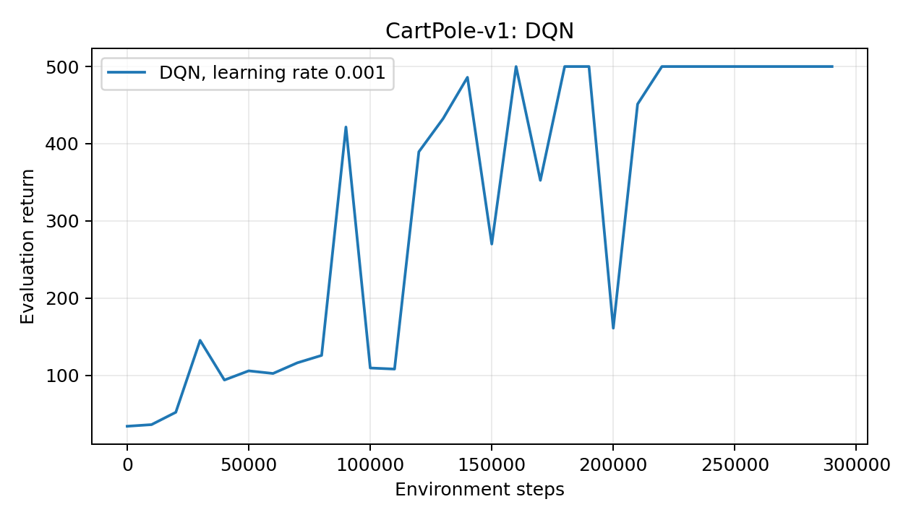
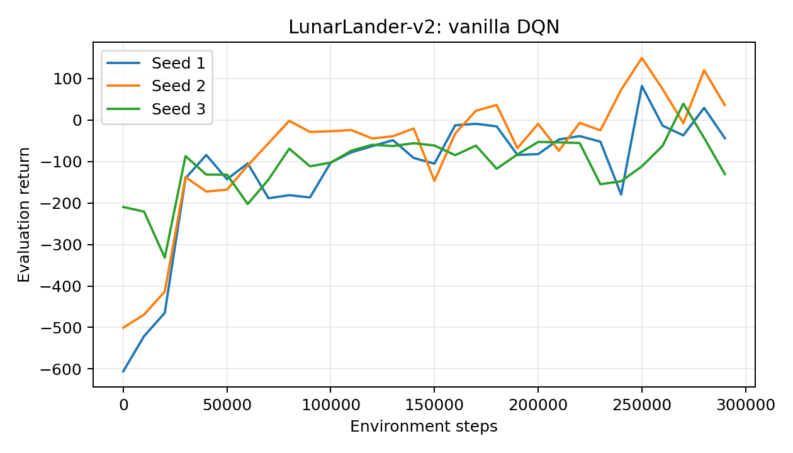
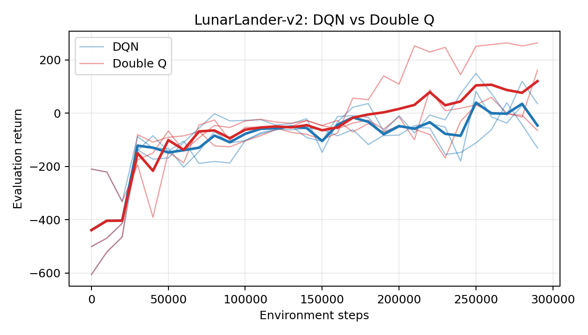
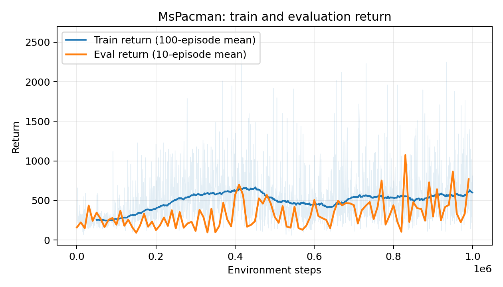
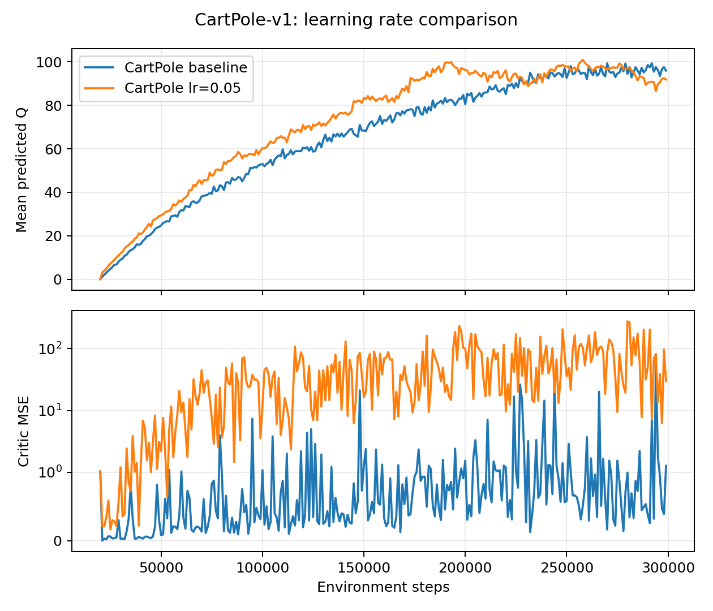
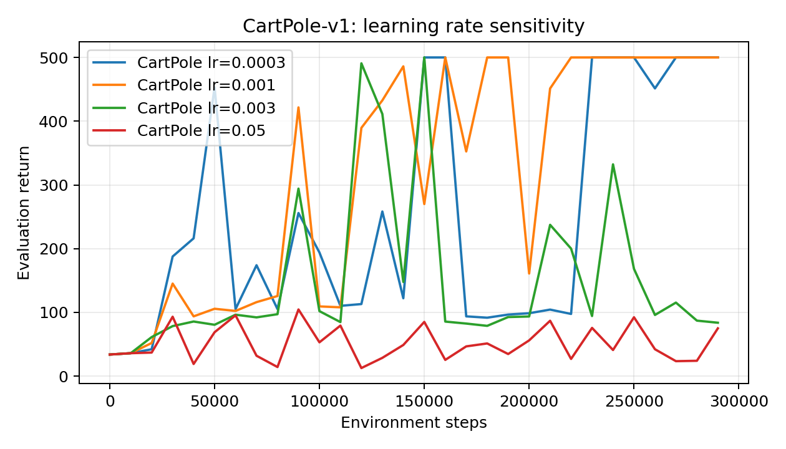

# HW3 第一题：DQN 实验结果

## 实验设置

- 环境：`CartPole-v1` 和 `LunarLander-v2`。
- 基线：题目提供的 `dqn_basic` 配置，训练 300,000 环境步；两层、每层 64 单元的 MLP；折扣因子 0.99；每 1,000 步同步目标网络；学习率 0.001；前 20,000 步只收集数据；batch size 128。
- 每 10,000 环境步评估一次，每次评估 10 个回合。最后一次评估发生在 290,000 步。
- CartPole 基线及学习率对照使用种子 1；LunarLander 使用种子 1、2、3。训练环境按各自种子初始化，评估环境使用对应种子加 10,000。
- `q_values` 是回放样本中所选动作的预测 Q 值均值；`critic_loss` 是该批次的 TD 目标均方误差。

## CartPole-v1

CartPole 的观测包含小车位置与速度、杆的角度与角速度，共 4 个连续数值；动作是向左或向右施加力。杆未倒且小车未越界时，每一步获得 1 分；本环境单回合最多 500 步。图中横轴为环境交互步数，纵轴为 10 回合的平均评估回报。

基线在 220,000 步达到 500 分，此后记录的评估均为 500 分。虽然在训练中也出现过回报下降，最终学到了能维持整回合的策略。

## LunarLander-v2：三个种子

| 种子 | 最后评估回报 | 最高评估回报 |
|---|---:|---:|
| 1 | -43.8 | 81.9 |
| 2 | 35.7 | 149.5 |
| 3 | -130.4 | 39.3 |

三个种子都没有在最后达到 200 分；训练过程中有明显波动，种子 2 曾达到 149.5，之后回落。题目明确指出普通 DQN 在此环境不一定达到 200，且可能出现上升后回落的现象。表中的数值是实际观测结果。

## Double Q-Learning：LunarLander 对照

Double Q 用在线网络选择下一动作，再用目标网络估计该动作的价值，使最大值运算与价值估计分开。

| 种子 | 普通 DQN 最后评估 | Double Q 最后评估 |
|---|---:|---:|
| 1 | -43.8 | 161.9 |
| 2 | 35.7 | -65.0 |
| 3 | -130.4 | 263.6 |
| 三种子均值 | -46.2 | 120.2 |

种子 1、3 的末次回报提高，种子 2 降低。红色的 Double Q 平均曲线在训练后期整体高于蓝色的普通 DQN 曲线；种子间差异仍明显。该结果与缓解过高估计的机制一致，但没有显示所有种子都稳定达到 200 分。

## Double Q-Learning：MsPacman

使用 `MsPacmanNoFrameskip-v0`、Double Q、四帧堆叠、四步跳帧与灰度输入，训练 1,000,000 环境步。CPU 运行配置采用 batch size 8、每 4 环境步更新一次、学习率 0.0001、每 2,000 步同步目标网络。

最后一次评估位于 990,000 步，十回合平均回报为 **769**；最高评估回报为 **1,074**（830,000 步）。训练回报的最近 100 回合均值从最初约 255 提高到最后约 600。

前期训练与评估曲线差异主要来自选动作方式：训练时 ε 在前 20,000 步保持为 1，随后逐步衰减；评估固定采用 ε=0.02。训练曲线汇总 100 个回合，评估曲线每点平均 10 个回合，后者的短期波动也更明显。

## CartPole：学习率 0.05

学习率从 0.001 提高至 0.05 后，预测 Q 值仍上升到约 90–100 的量级，并未无界发散；但是其 critic 误差明显更大、波动更剧烈。按记录点计算，`critic_loss` 的中位数约由 0.51 增至 30.74，最后评估回报从 500 降至 75。较大的更新步长使基于自举目标的 Q 估计难以稳定拟合；经验回放带来的离策略数据、函数近似与自举共同作用，可能放大这种不稳定性。不能仅凭较高的预测 Q 值判断策略表现良好。

## 超参数敏感性：四档学习率

选择学习率，是因为它直接控制每次 Q 网络更新的幅度，适合观察自举目标下的训练稳定性。除第一题的 0.001 外，比较 0.0003、0.003、0.05；四档配置文件见 `experiments/dqn/hyperparameters/`。0.001 和 0.05 的运行复用了数值设置相同的基线及前述对照实验。

| 学习率 | 最后评估回报 | 最高评估回报 |
|---|---:|---:|
| 0.0003 | 500.0 | 500.0 |
| 0.001 | 500.0 | 500.0 |
| 0.003 | 83.8 | 500.0 |
| 0.05 | 75.0 | 104.6 |

0.0003 和 0.001 最终达到 500；0.003 中途达到过 500，但未保持；0.05 的表现最差。单一种子的结果只能说明这次运行的敏感性，不能作为各学习率期望性能的统计估计。

图表的 PDF 版本与 PNG 同名；`scalars.csv` 保存绘图用的原始标量数据。训练原始日志保存在 `data/`，运行输出保存在本目录的 `.log` 文件。
